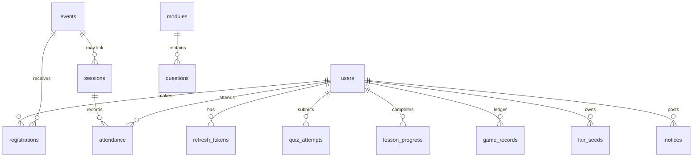
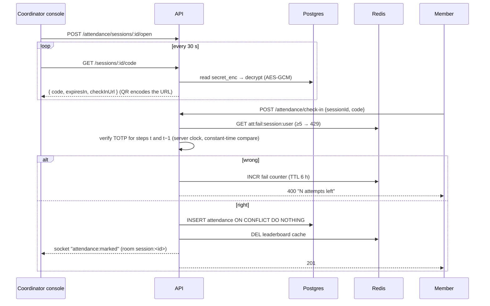

# Sambhav Platform — System Design

> Club portal for the Sambhav Game Theory & Strategy Society: a game-theory **Arena**, an **LMS** (modules, Bloom-tagged quizzes, progress), **events**, **TOTP/QR attendance**, **member records**, **leaderboard**, and **notices**.

## 1. Requirements

### Functional
| Area | Requirement |
|---|---|
| Identity | Register / sign in; roles **ADMIN › COORDINATOR › MEMBER** (hierarchical RBAC); profile; soft-deactivation |
| Arena | Roulette (provably fair), Prisoner's Dilemma (+ Axelrod tournament & replicator dynamics), Guess-⅔ (level-k bots), RPS (pattern-exploiting bot), Nash solver (pure + mixed), sealed-bid auctions (first/second price), ultimatum (proposer/responder), **live multiplayer ⅔ rounds** |
| LMS | 6 modules · learning outcomes · lessons · 36 quiz items spanning Bloom L1–L6, answer keys withheld until submission, best-score tracking, lesson progress |
| Events | CRUD (coordinators), capacity-safe registration, registrant lists |
| Attendance | Sessions; rotating 6-digit TOTP + QR on a projector console; real-time check-in feed; manual roll call; lockout after 5 wrong codes; per-member rates; register matrix + CSV |
| Records | Member directory, per-member summary (attendance, points, rank, badges), audit log |
| Leaderboard | Arena points + 5 × correct answers (best per module) + 10 × sessions attended |

### Non-functional
| NFR | Target | How |
|---|---|---|
| Latency | p95 < 150 ms for reads | Indexed queries, 30 s leaderboard cache, gzip, immutable hashed assets |
| Burst | 300 check-ins in 60 s at the start of a meeting (≈5 rps, peaks ~20 rps) | Stateless API, single-row insert with unique index, no locks |
| Integrity | No forged points, no double attendance, no overbooking, no overspend | Server-authoritative games, unique constraints, SERIALIZABLE + retry, conditional updates |
| Security | OWASP ASVS L1 | bcrypt(12), short-lived JWT in memory, rotating httpOnly refresh cookie with reuse detection, Helmet, CORS allow-list, rate limits, Zod validation, AES-256-GCM secrets at rest, audit log |
| Availability | Club scale: single region, 99.5% | Health/readiness probes, graceful shutdown, Postgres as source of truth, Redis optional (falls back to memory) |
| Scale-out | 10× (university-wide, ~10 k users) without redesign | Stateless replicas behind Nginx, Redis rate-limit store + Socket.IO adapter, read replicas if ever needed |

### Capacity estimate (university-wide ceiling)
* 10 000 users · 2 000 DAU · ~40 requests/user/day → **~80 k req/day ≈ 1 rps avg, ~50 rps peak** (one node handles >1 000 rps for these queries).
* Storage: game ledger ≈ 2 000 users × 50 plays/day × 300 B ≈ **30 MB/day** → ~10 GB/year; attendance is negligible (≈ 1 row per member per session).

## 2. High-level architecture

```mermaid
flowchart LR
  subgraph Client
    W[React SPA<br/>React Query cache]:::c
    P[Projector console<br/>QR + TOTP]:::c
  end
  W -- HTTPS --> N[Nginx edge<br/>TLS · gzip · static · proxy]
  P -- HTTPS/WSS --> N
  N -- /api --> A1[API replica 1<br/>Express + Socket.IO]
  N -- /api --> A2[API replica N]
  N -- /socket.io --> A1
  A1 & A2 --> PG[(PostgreSQL 16<br/>source of truth)]
  A1 & A2 --> R[(Redis 7<br/>rate limits · round state · LB cache · pub/sub)]
  A1 <-. Socket.IO Redis adapter .-> A2
  classDef c fill:#e3edf8,stroke:#14549a
```

**Monorepo layout**

```
packages/game-core   pure TS engines (roulette, PD, Nash, auctions, ultimatum, RPS, level-k, provably-fair RNG)
apps/api             Express + Drizzle ORM + Postgres + Redis + Socket.IO
apps/web             React 18 + Vite + React Query + Socket.IO client
infra/               Nginx edge config
docs/                this document, API reference
```

`game-core` is shared: the **API uses it authoritatively** (outcomes and points) and the **web app uses the same code** for instant client-side tools (Nash solver, EV preview, seed verification). One implementation, one test suite.

## 3. Data model



| Table | Key constraints / indexes | Notes |
|---|---|---|
| `users` | `email` unique, `roll_no` unique, idx `role` | `credits` = virtual bankroll; soft delete via `is_active` |
| `refresh_tokens` | `token_hash` unique, idx `family` | SHA-256 of the token only; rotation family for reuse detection |
| `events` | idx `starts_at` | |
| `registrations` | **unique (event_id, user_id)** | capacity enforced in SERIALIZABLE tx |
| `sessions` | idx `date`, `status` | `secret_enc` = AES-256-GCM(TOTP secret) |
| `attendance` | **unique (session_id, user_id)**, idx `user_id` | `method` ∈ CODE / QR / MANUAL, `marked_by` for audits |
| `modules`, `questions` | unique (module_id, order) | outcomes/lessons JSONB; Bloom level enum L1–L6 |
| `quiz_attempts` | idx (user_id, module_id) | leaderboard uses MAX(score) per module |
| `game_records` | idx (user_id, game), `created_at` | **append-only ledger** — points are never mutated, only appended |
| `fair_seeds` | idx (user_id, active) | commit–reveal seeds with per-user nonce |
| `audit_log` | idx (entity, entity_id), `created_at` | every privileged write |

## 4. Key flows

### 4.1 Attendance check-in (TOTP)



Why this design: the secret never leaves the server; the code expires in ≤ 60 s so a forwarded screenshot goes stale; the member's clock is never trusted; the unique index makes retries and double scans harmless; coordinators can always fall back to roll call.

### 4.2 Provably-fair roulette spin

1. `GET /games/fair` → `sha256(serverSeed)`, client seed, nonce (commit).
2. `POST /games/roulette/spin {bets}`
   * validate bets and stake ≤ credits;
   * **compare-and-set the nonce** (`UPDATE … WHERE nonce = :n`) so concurrent spins can't reuse an outcome;
   * outcome = `HMAC-SHA256(serverSeed, clientSeed:nonce)` → 32-bit words → **rejection sampling** into 0–36 (no modulo bias);
   * **conditional debit** `UPDATE users SET credits = credits + net WHERE credits ≥ stake` (no overspend under concurrency);
   * append to `game_records`, invalidate leaderboard.
3. `POST /games/fair/rotate` reveals the old seed; the client recomputes every past result with the same `game-core` function.

### 4.3 Event registration under contention
`SERIALIZABLE` transaction: read event → return existing registration if any (idempotent) → count → insert. On SQLSTATE `40001` the API retries with jittered exponential backoff (4 attempts). Integration test fires 6 concurrent registrations at a 2-seat event and asserts ≤ 2 succeed.

### 4.4 Leaderboard
Single SQL aggregate over the ledger, attendance and best quiz scores (`LEFT JOIN` of three grouped sub-queries) → cached in Redis for 30 s (**cache-aside**) and invalidated on every point-changing write. At 10 k users this is a few ms; a materialised view is the next step if it ever isn't.

### 4.5 Live Arena (multiplayer ⅔ round)
Socket.IO room `arena:live`. A coordinator emits `live:start`; members emit `live:guess` (acked); a **server-side timer** closes the round, scores it with `game-core`, writes ledger rows and broadcasts `live:result`. The round is owned by the node that started it (one round per club night); the Redis adapter fans events out to every replica.

## 5. API surface (v1)
See [`API.md`](./API.md). Conventions: JSON, `/api/v1` prefix, errors as `{ error: { code, message, details? } }`, 400 validation · 401 auth · 403 role · 404 · 409 conflict · 429 rate limit.

## 6. Security
| Threat | Control |
|---|---|
| Credential stuffing | 10 auth attempts / 15 min / IP (Redis-backed) **and** 5 failures per account → 15-min lock, bcrypt cost 12, uniform-time login (dummy hash) |
| Admin takeover | Attendance runs only under the ADMIN role (username `udbhav`); password change/reset needs an SMS OTP to the registered mobile (6 digits, CSPRNG, hashed in Redis, 5-min TTL, single use, 5 tries, 3 sends/15 min); every change revokes all sessions and is audited; the mobile number is set only from server config and never returned in full |
| Token theft (XSS) | Access token in memory only (15 min); refresh token httpOnly + SameSite=strict + path-scoped cookie |
| Refresh replay | Rotation on every use; replaying a rotated token revokes the whole family and is audited |
| Privilege escalation | Hierarchical RBAC middleware; only admins change roles; "last admin" guard; members can't set club titles |
| Point forgery | All outcomes computed server-side; client never submits a score |
| Attendance fraud | Server-side TOTP, 60 s validity, 5-attempt lockout, secret encrypted at rest, audit of manual marks |
| Injection | Parameterised queries (Drizzle), Zod validation on every body/query/param, UUID params |
| Abuse | Global 600 req/min/user, games 240 req/min/user, JSON body limit 100 kB |
| Transport / headers | TLS at Nginx, Helmet, CSP-friendly SPA, `X-Frame-Options: DENY` |

## 7. Reliability & operations
* `/healthz` (liveness) and `/readyz` (Postgres + Redis) for orchestration; Docker `HEALTHCHECK`.
* Graceful shutdown closes HTTP, Postgres pool and Redis.
* Structured JSON logs (pino) with secrets redacted.
* Migrations are versioned SQL (`apps/api/drizzle`) applied on container start; seeds are idempotent upserts.
* Backups: nightly `pg_dump` + Postgres WAL archiving if hosted; Redis holds only ephemeral data (safe to lose).

## 8. Testing
| Layer | What | Count |
|---|---|---|
| `game-core` unit | fairness (χ² uniformity), SHA-256 vector, roulette settlement & EV, PD/TFT, replicator dynamics, Nash (PD, BoS, RPS, quiz item), level-k, auctions, ultimatum, RPS exploitation | 19 |
| API unit | RFC 6238 TOTP vectors, time window, AES-GCM tamper detection, KV | 4 |
| API integration (real Postgres) | auth + refresh reuse, RBAC, events capacity & concurrency, attendance (window, lockout, manual, CSV), quiz grading & answer withholding, roulette verification & concurrent spins, PD/auction/ultimatum/Nash, leaderboard math, health | 21 |
| Realtime | socket auth, live check-in push, live ⅔ round | 2 |

## 9. Evolution path
1. SSO with the university IdP (OIDC) — replaces password auth, keeps RBAC.
2. Materialised leaderboard view + nightly snapshot for term-wise rankings.
3. Background jobs (BullMQ) for e-mail reminders and certificate PDFs.
4. Move live-round state to Redis hashes for multi-node ownership.
5. Analytics: per-question difficulty / discrimination index from `quiz_attempts`.

## Vihaan (AI guide) and production edge

| Concern | Design |
|---|---|
| Request path | Browser → Caddy/Nginx (SSE unbuffered) → Express `POST /api/v1/ai/chat` → instant router → offline answer **or** Claude tool loop (≤ 5 rounds) |
| Grounding | Four server tools: `navigate` (allow-listed public pages), `get_club_snapshot`, `search_site`, `get_my_progress` (JWT user only) |
| Failure modes | No key, quota or daily cap reached → offline mode from live Postgres data; model error → friendly SSE `error` event; client abort cancels the upstream stream |
| Rate limiting | Global API limiter keyed by user id (JWT) or IP; auth limiter keyed by (IP, account) plus per-IP ceiling — safe for campus NAT |
| Deployment unit | One container (API + SPA via `WEB_DIST`) behind an HTTPS edge; Postgres + Redis managed or in Compose; horizontal scale via the Socket.IO Redis adapter |
| Details | [VIHAAN.md](VIHAAN.md) · [DEPLOY.md](DEPLOY.md) |
